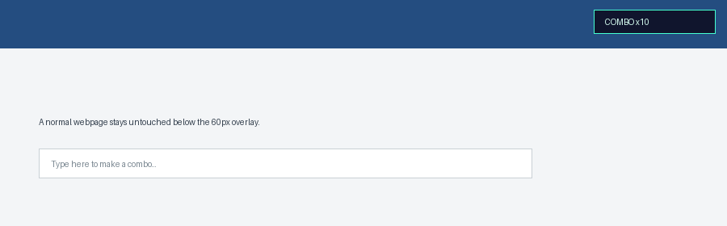
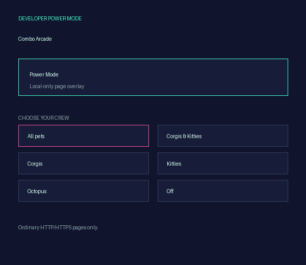
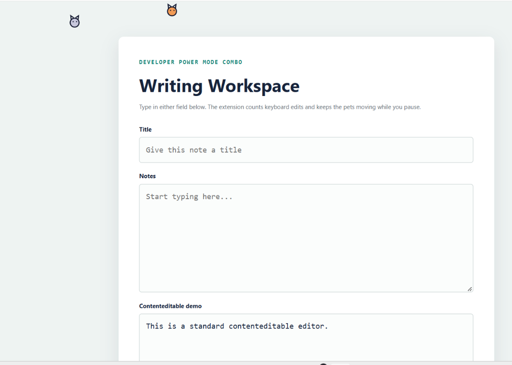

# Developer Power Mode Combo

Developer Power Mode Combo is a local-only Chrome Manifest V3 extension. It adds an arcade-style combo counter and a tiny pixel-pet scene to the top 60 pixels of permitted HTTP/HTTPS webpages.






## What it does

- Counts confirmed keyboard-driven edits in ordinary text inputs, textareas, and standard `contenteditable` elements.
- Ignores passwords, shortcuts, paste/drop/replacement input, and programmatic changes.
- Handles IME composition without double-counting.
- Resets after 1.5 seconds of inactivity or when changing editors; every tenth hit briefly shakes the counter, never the page.
- Animates up to three independent Corgis, Kitties, or Octopuses. Octopuses swim with tentacles and release spreading ink clouds.
- Adds translucent water and swaying seaweed for **All pets** and **Octopus** modes.
- Pauses when the page is hidden and honors reduced motion with a static counter.
- Stores only preferences and the numeric combo in `chrome.storage.local`; typed content is never saved, logged, or transmitted.

Compatibility is intentionally limited to ordinary HTTP/HTTPS pages. Restricted Chrome pages and every custom editor are not promised to work.

## Install unpacked

1. Open `chrome://extensions`.
2. Enable **Developer mode**.
3. Click **Load unpacked**.
4. Select this folder: `C:\Users\snibchua\Documents\Developer Power Mode Combo`.
5. Open an HTTP/HTTPS page, then click the extension icon to choose a mode.
6. To test without another website, click **Open typing demo** in the extension popup.

No backend, API keys, background worker, external assets, or store-publishing setup is required.

## Tests

Run focused tests from this folder:

```bash
node --test tests/extension.test.js
```

The screenshots and GIF in `assets/` are local project documentation assets; the extension itself bundles no remote resources.
